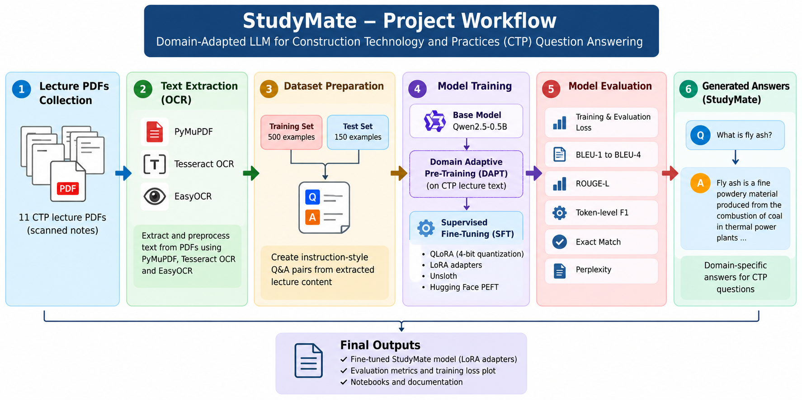

# StudyMate — CTP Question-Answering Prototype

StudyMate is a domain-adapted language-model prototype for answering questions about **Construction Technology and Practices (CTP)** lecture material.

## Project Workflow



1. **Lecture material:** 11 scanned CTP lecture PDFs.
2. **Text extraction:** PyMuPDF, Tesseract OCR, EasyOCR, and Python.
3. **Dataset preparation:** Instruction-style question-and-answer examples created from extracted lecture content.
4. **Domain adaptation (DAPT):** Qwen2.5-0.5B adapted to CTP lecture text.
5. **Supervised fine-tuning (SFT):** Fine-tuned with QLoRA, 4-bit quantization, LoRA adapters, Unsloth, Hugging Face Transformers, and PEFT.
6. **Evaluation:** Generated answers evaluated using text-overlap metrics and evaluation loss/perplexity.

## Model and Training Setup

- **Base model:** Qwen2.5-0.5B
- **DAPT adapter:** [`ksumanthreddy96/studymate-ctp-dapt`](https://huggingface.co/ksumanthreddy96/studymate-ctp-dapt)
- **SFT training examples:** 500
- **SFT evaluation examples:** 150
- **Epochs configured:** 3
- **Learning rate:** `1e-5`
- **Maximum sequence length:** 256
- **Fine-tuning approach:** QLoRA with 4-bit quantization and LoRA adapters

## Evaluation Results

| Metric | Result |
|---|---:|
| Evaluation loss | 3.7138 |
| Perplexity | 41.0083 |
| BLEU-1 | 0.1344 |
| BLEU-2 | 0.0944 |
| BLEU-3 | 0.0738 |
| BLEU-4 | 0.0599 |
| Mean token F1 | 0.1852 |
| Mean ROUGE-L | 0.1777 |
| Exact-match rate | 0.00 (0%) |

Place the training/evaluation loss plot in `results/loss_curves.png` and the metrics JSON in `results/evaluation_metrics.json` if you want them to appear in the repository.

## Repository Structure

```text
StudyMate/
├── README.md
├── requirements.txt
├── .gitignore
├── notebooks/
│   ├── DAPT_Training.ipynb
|   |── DAPT_data_preparation.ipynb
│   └── SFT_Training_Evaluation.ipynb
├── results/
    ├── sft_evaluation_report.json
    └── loss_curves.png
```

The structure above is a suggested layout. Include only files that exist in your repository and update notebook filenames to match your actual files.

## Technologies

- Python and PyTorch
- PyMuPDF, Tesseract OCR, and EasyOCR
- Hugging Face Transformers and Hugging Face Hub
- Unsloth, PEFT, LoRA, and QLoRA

## Limitations

- The source documents were scanned PDFs, so OCR output may contain errors or fragments.
- BLEU and ROUGE-L measure text overlap with reference answers; they do **not** establish factual correctness.
- The 150 SFT evaluation examples were held out from SFT training, but their source PDFs were also used during DAPT. Therefore, this is not a fully independent test on unseen source documents.
- The current results indicate that answer quality needs further improvement and should be validated with human review and factual checks.

## Reproducibility Notes

The training notebooks document the preprocessing, fine-tuning, and evaluation workflow. Training requires a compatible GPU environment and the relevant Python packages. Review the notebooks and `requirements.txt` for the exact setup used.

## License and Data

Add a license before redistributing this project. Ensure you have permission to share any lecture materials or derived datasets. The original lecture PDFs and large model-weight files are intentionally not included by default.

